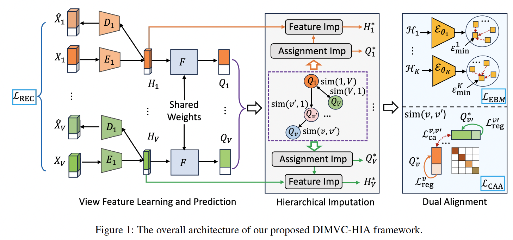

# DIMVC-HIA: Deep Incomplete Multi-View Clustering via Hierarchical Imputation and Alignment

**Yiming Du, Ziyu Wang, Jian Li, Rui Ning, and Lusi Li***

Department of Computer Science, Old Dominion University, Norfolk, VA, USA

*Corresponding Author: Lusi Li*

📄 **Published in AAAI 2026 (AAAI-26)**

🔗 **[Code](https://github.com/YMBest/DIMVC-HIA)**

---

## 📖 Overview

**DIMVC-HIA (Deep Incomplete Multi-View Clustering via Hierarchical Imputation and Alignment)** is a deep incomplete multi-view clustering (IMVC) framework designed to learn robust and discriminative representations from multi-view data with partially missing observations.

Existing IMVC approaches face two fundamental challenges:

- **Imputation Error Propagation:** Inaccurate recovery of missing views can introduce biases and distort the underlying cluster structures.
- **Representation Uncertainty:** Missing observations can weaken cross-view semantic consistency and reduce the reliability of clustering assignments.

To address these challenges, DIMVC-HIA integrates **hierarchical imputation** and **dual alignment mechanisms** into a unified learning framework.

Extensive experiments on four benchmark datasets demonstrate the effectiveness of DIMVC-HIA under varying levels of missing-view incompleteness.

This repository provides the **official PyTorch implementation** of DIMVC-HIA.

## 🏗️ Framework



The framework consists of three main stages:

1. **View Feature Learning and Prediction:** View-specific autoencoders extract latent features, while a shared clustering predictor generates soft cluster assignments.
2. **Hierarchical Imputation:** Missing cluster assignments are first estimated through cross-view semantic similarity, followed by cluster-guided latent feature imputation.
3. **Dual Alignment:** Energy-based semantic alignment and contrastive assignment alignment jointly improve cluster compactness and cross-view consistency.

## ⚙️ Requirements

The implementation is based on **Python and PyTorch**.

**Core Dependencies**

- Python
- PyTorch
- NumPy
- scikit-learn

Please refer to the repository's environment configuration for the complete dependencies and version requirements.

## 📊 Datasets

DIMVC-HIA is evaluated on four benchmark multi-view datasets:

| Dataset | Samples | Views | Clusters |
|---|---:|---:|---:|
| BDGP | 2,500 | 2 | 5 |
| MNIST-USPS | 5,000 | 2 | 10 |
| Fashion-MNIST | 10,000 | 3 | 10 |
| Handwritten | 2,000 | 6 | 10 |

The experiments consider four missing-view ratios:

**η ∈ {0.1, 0.3, 0.5, 0.7}**

Clustering performance is evaluated using:

- **Clustering Accuracy (ACC)**
- **Normalized Mutual Information (NMI)**
- **Purity (PUR)**

## 🚀 Experimental Configuration

The experimental settings reported in the paper are summarized below.

| Parameter | Setting |
|---|---|
| Framework | PyTorch |
| Latent feature dimension | 2000 |
| Learning rate | 0.0001 |
| Pre-training epochs | 100 |
| Fine-tuning epochs | 200 |
| Energy alignment weight (α) | 0.1 |
| Contrastive alignment weight (β) | 0.01 |
| GPU | NVIDIA RTX 3080 |

**Batch Sizes**

| Dataset | Batch Size |
|---|---:|
| BDGP | 200 |
| MNIST-USPS | 50 |
| Fashion-MNIST | 100 |
| Handwritten | 200 |

For executable training and evaluation commands, please refer to the scripts provided in the repository.

## 📈 Experimental Results

DIMVC-HIA demonstrates competitive clustering performance across four benchmark datasets under different missing-view ratios.

### Clustering Accuracy (ACC, %)

| Dataset | η = 0.1 | η = 0.3 | η = 0.5 | η = 0.7 |
|---|---:|---:|---:|---:|
| BDGP | **98.40** | **96.25** | **95.16** | **92.32** |
| MNIST-USPS | **99.10** | **97.54** | **96.48** | **93.66** |
| Fashion-MNIST | **98.84** | **97.16** | **96.51** | **95.27** |
| Handwritten | **96.85** | **96.35** | **95.15** | **94.05** |

The results demonstrate that DIMVC-HIA maintains high clustering accuracy even under severe missing-view conditions.

In particular, at a **70% missing-view ratio**, DIMVC-HIA achieves:

- **95.27% ACC** on Fashion-MNIST.
- **94.05% ACC** on Handwritten.
- **92.32% ACC** on BDGP.
- **93.66% ACC** on MNIST-USPS.

### Ablation Study

The ablation experiments evaluate the contributions of three key learning objectives:

- **Reconstruction Loss (L_REC):** Supports stable view-specific representation learning.
- **Energy-Based Alignment Loss (L_EBM):** Promotes semantic consistency and intra-cluster compactness.
- **Contrastive Assignment Alignment Loss (L_CAA):** Enhances cross-view assignment consistency and clustering discrimination.

The results demonstrate that all three components contribute to the overall performance, with contrastive assignment alignment playing a particularly important role.

## 📚 Citation

If you find this repository useful in your research, please cite our paper:

**Yiming Du, Ziyu Wang, Jian Li, Rui Ning, and Lusi Li.**  
"Deep Incomplete Multi-View Clustering via Hierarchical Imputation and Alignment."  
*Proceedings of the AAAI Conference on Artificial Intelligence*, vol. 40, no. 25, pp. 20941–20949, 2026.

```bibtex
@inproceedings{du2026deep,
  title={Deep Incomplete Multi-View Clustering via Hierarchical Imputation and Alignment},
  author={Du, Yiming and Wang, Ziyu and Li, Jian and Ning, Rui and Li, Lusi},
  booktitle={Proceedings of the AAAI Conference on Artificial Intelligence},
  volume={40},
  number={25},
  pages={20941--20949},
  year={2026}
}
```

## 📬 Contact

For questions regarding the implementation, experimental results, or research collaboration, please open an issue in this repository or contact:

## 🙏 Acknowledgments

This work was supported in part by:

- **National Science Foundation (NSF):** CNS-2153358 and CNS-2245918
- **DoD CoE-AIML:** W911NF-20-2-0277
- **Commonwealth Cyber Initiative (CCI and COVA CCI)**
